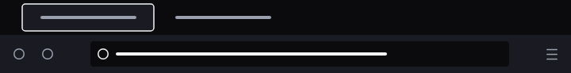

# Obsidian Silver

A near-black Firefox theme with cool silver accents.

> **Firefox only.** This theme works in Mozilla Firefox and is not compatible with other browsers.

<!-- Replace with your screenshot: save it as screenshots/preview.png -->

## Installation

Install from the Firefox Add-ons store:

**[addons.mozilla.org/en-US/firefox/addon/obsidian-silver](https://addons.mozilla.org/en-US/firefox/addon/obsidian-silver/)**

Once installed, the theme applies automatically. You can switch it off or change it from **Add-ons and Themes → Themes** in Firefox.

## License

[MIT](LICENSE)
